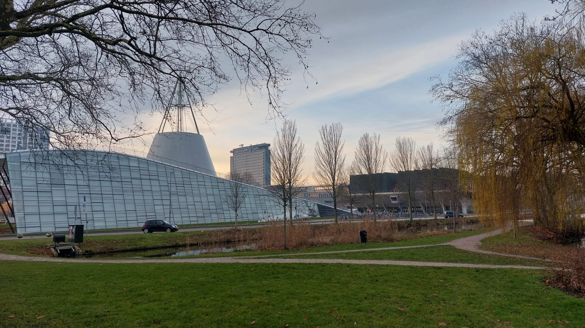

+++ { "kind": "split-image" }

# Dynamic Modeling & Transport Phenomena in Fixed-Bed Catalytic Reactors

**Double Bachelor of Science Thesis in Applied Physics & Applied Mathematics**  
*Delft University of Technology*

**Author:** Lucas van Dekken  
**Departments:** Catalysis Engineering (ChemE / TNW) & Delft Institute of Applied Mathematics (DIAM / EEMCS)

{button}`GitHub Repository <https://github.com/AsapLoso/Methanol-Catalysis>`
{button}`Explore Theory <./Theory.md>`
{button}`BEP Model Notebook <./c2h2_hydrogenation_transient_model.ipynb>`



+++

## Executive Project Overview

This thesis investigates the non-linear dynamics, transport phenomena, and numerical modeling of fixed-bed catalytic reactors under forced periodic operation. Combining continuum physics with numerical mathematics, the primary focus centers on the selective semi-hydrogenation of acetylene ($C_2H_2 \rightarrow C_2H_4$) over heterogeneous bimetallic palladium catalysts.

### 🔬 Applied Physics Core (TNW / ChemE)
- **Multi-Scale Transport Balances:** Derivation of the one-dimensional Axial Dispersion Model (ADM) coupling plug flow convective transport, effective axial dispersion ($Pe_a$), and intra-pellet diffusional resistance.
- **Gas-Solid Surface Kinetics:** Formulation of dynamic Langmuir-Hinshelwood-Hougen-Watson (LHHW) rate expressions tracking unmeasurable, transient surface coverage states $\theta_i(x,t)$.
- **Dynamic Forcing:** Analyzing how periodic inlet concentration pulsing breaks static equilibrium constraints to enhance intermediate ethylene selectivity.

### 📐 Applied Mathematics Core (DIAM / EEMCS)
- **Spatial Semi-Discretization:** Method of Lines (MOL) implementation using first-order Upwind schemes, enforcing strict downstream causality and eliminating stiff spatial matrix inversions.
- **Stiff Time Integration:** Evaluating implicit multi-step and Runge-Kutta solvers (BDF / Radau) to resolve the disparate timescales between fast catalytic surface chemistry and slow convective gas transport.
- **Periodic Limit Cycles:** Establishing an open-loop forward propagation framework to evaluate the impact of modulation frequency and wave parameters on cumulative yield.

---

## 📚 Thesis Structure & Quick Navigation

| Chapter | Focus Area | Key Content |
|---|---|---|
| [**1. Introduction**](./Introduction.md) | Industrial Context & Scope | Ethylene purification, limitations of steady-state PBRs, and dynamic excitation rationale. |
| [**2. Theory**](./Theory.md) | Physical & Chemical Formulation | Continuum conservation PDEs, Danckwerts boundary conditions, and dimensionless scaling ($Pe, Da$). |
| [**3. Methods**](./Methods.md) | Numerical Discretization | Method of Lines (MOL), Upwind scheme stability, and ODE system staging in Python. |
| [**4. BEP Model Notebooks**](./c2h2_hydrogenation_transient_model.ipynb) | Three reactor-notebook snapshots | Review the [legacy inline scaffold](./c2h2_hydrogenation_transient_model.ipynb), [V1](https://github.com/AsapLoso/Methanol-Catalysis/blob/791e51c0eba11f4bd5095f48d0520c6af317f5f8/notebooks/bep_dynamic_reactor_response.ipynb), and [V2](https://github.com/AsapLoso/Methanol-Catalysis/blob/2ee0dc1a84529d6830dcc628fc771878907fb22c/notebooks/bep_dynamic_reactor_response.ipynb); V1/V2 remain on open PR branches ([#1](https://github.com/AsapLoso/Methanol-Catalysis/pull/1), [#2](https://github.com/AsapLoso/Methanol-Catalysis/pull/2)). [Results.ipynb](./Results.ipynb) is a generic interactive linear-fit placeholder, not a BEP reactor result. |
| [**5. Conclusion**](./Conclusion.md) | Synthesis & Outlook | Key findings, model validity domain, and experimental verification roadmap in the Urakawa Lab. |

---

## 👥 Graduation Committee & Research Supervision

| Position on Form TWN3002-24 | Staff Member | Department & Affiliation |
|---|---|---|
| **First Supervisor & 1st Examiner (TN)** | **Dr. Bijoy Bera** | Assistant Professor, Transport Phenomena (ChemE / TNW) |
| **First Supervisor & 1st Examiner (TW)** | **Dr.ir. Zoë Gromotka** | Assistant Professor, Mathematical Physics (DIAM / EEMCS) |
| **Daily Supervisor & Catalysis Lead** | **Damian Vico van Berkel** | PhD Candidate, Catalysis Engineering (ChemE / TNW) |
| **Second Examiner (TW)** | **Dr. N.V. (Neil) Budko** | Associate Professor, Numerical Analysis (DIAM / EEMCS) |
| **Second Examiner (TN)** | **Dr. C.S. (Carlas) Smith** | Associate Professor, Systems & Control (DCSC / 3mE-TNW) |
| **Laboratory Head / Advisor** | **Prof. dr. Atsushi Urakawa** | Full Professor, Catalysis Engineering Group (ChemE / TNW) |

---

```{note}
This interactive thesis is authored using the **TU Delft Open Publishing Platform** (Jupyter Book v2 / MyST Markdown) and compiles to a print-ready Typst PDF document.
```

